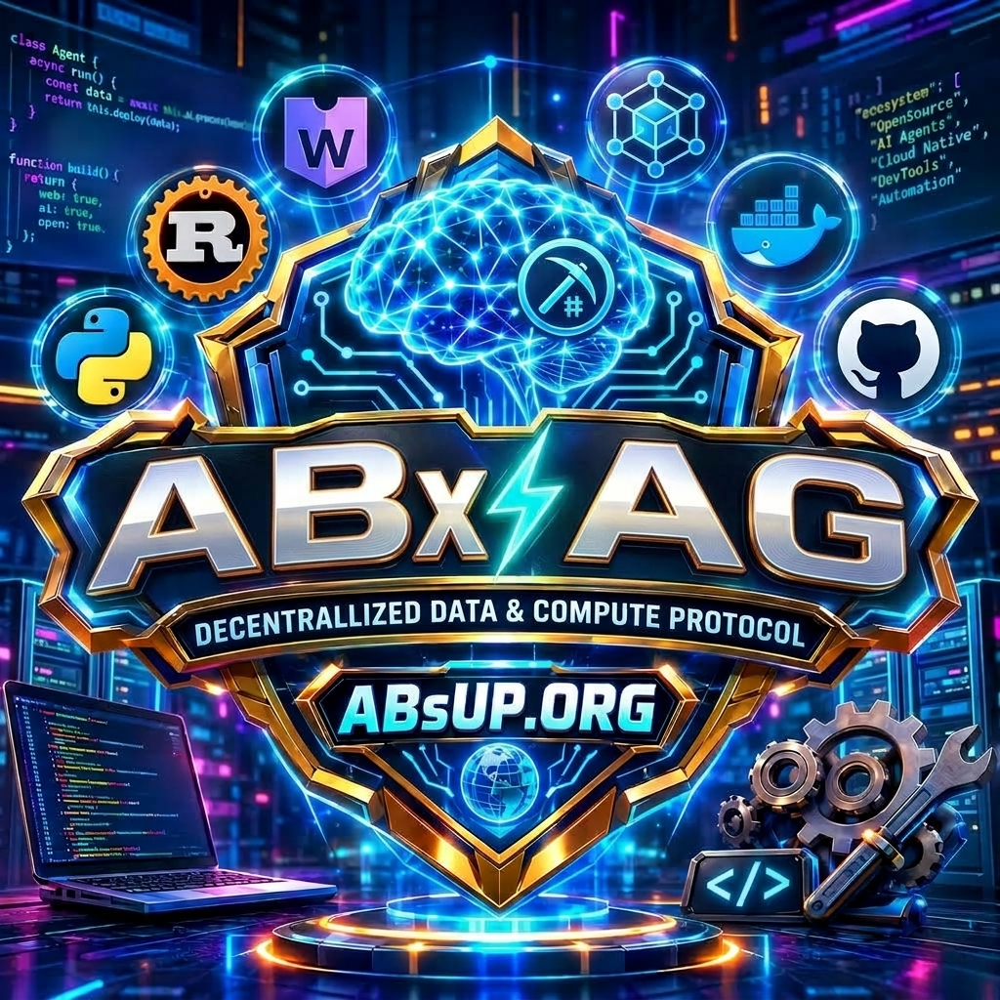

<p align="center">
  
</p>

<h1 align="center">ABxAG</h1>

<p align="center">Current version: <b>v1.1.23</b> · <a href="https://github.com/ABxAG/ABxAG/releases">changelog</a></p>

<p align="center">
  <b>Your private 3D AI desktop companion.</b><br />
  Talks with you by voice, sees your screen when you allow it, controls apps and files —
  powered by your own Gemini API key. No cloud account. No subscription.
</p>

<p align="center">
  <a href="https://github.com/ABxAG/ABxAG/actions/workflows/ci.yml"></a>
  <a href="https://github.com/ABxAG/ABxAG/releases/latest"></a>
  
  
  
</p>

<p align="center">
  <a href="https://abxag.absup.dev/DownLoad/"><b>⬇ Download</b></a> ·
  <a href="https://abxag.absup.dev/RoadMap/">Roadmap</a> ·
  <a href="https://abxag.absup.dev/">Website</a> ·
  <a href="https://github.com/ABxAG/ABxAG/releases">All releases</a>
</p>

---

## ✨ Features

| Era | What you get |
|---|---|
| 🎙 **Voice companion** | Real-time conversation via Gemini Live, “Hey AB” wake word, reminders & alarms, quiet hours |
| 👁 **Eyes** | Screen vision + OCR; screen text is always treated as untrusted data |
| 🖐 **Hands** | 96 local PC tools (apps, files, input, browser, clipboard) gated by confirmations, an emergency stop and a permission board |
| 🧠 **Memory & mind** | Local cognition runtime: episodic memory, goals, learned skills, curiosity and presence |
| 🧍 **Body** | three.js character engine — import any `.pmx / .vrm / .glb / .fbx / .obj` model, `.zip` or folder (Character Studio included) |
| 🖱 **Reliable hands** | She drives your physical mouse with exact text labels, pauses the moment you touch the PC, and every risky action goes through confirmations + emergency stop |
| 🔄 **Auto-update** | Hybrid updater: fast differential installs for the current version, one-click switch to any older version, mirror-feed fallback |

## ⬇ Download

> Prefer one click? Get everything at **https://abxag.absup.dev/DownLoad/** — it auto-detects your OS.

| Platform | Build | Status |
|---|---|---|
| Windows 10/11 64-bit | **Setup** (installer + differential auto-updates) | ✅ Recommended |
| Windows 10/11 64-bit | **Portable** (single file, guided updates) | ✅ Available |
| Linux x64 | **AppImage** (chat/voice/memory UI; *no PC control*) | 🧪 Experimental |
| macOS | — | 🔜 Planned |

## 🚀 Quick start

**Just use it:** install the Setup `.exe` → paste your free Gemini key (from
https://aistudio.google.com) → **Import my character** → say “Hey AB”.

**Run from source:**

```powershell
npm install
pip install -r desktop_agent/requirements.txt
npm run dev        # → http://localhost:3000
```

```powershell
npm run app        # desktop app (Electron + companion)
```

The first screen asks for your Gemini API key — stored encrypted with Windows
DPAPI in your user-data folder, never in the project. Optional: copy
`.env.example` to `.env` for dev settings (never put a real key in a file you share).

**Build the public installer:**

```powershell
pip install pyinstaller
pyinstaller desktop_agent.spec --distpath agent_dist --workpath agent_build
npm run dist:public   # → release-public/ABxAG-Setup-<version>.exe
```

`npm run dist` expects a character in `assets/characters/` (not included); use `dist:public`.

## 🛠 Tech stack

- **UI:** React 19 · Vite 6 · Tailwind 4 · Three.js (MMD/PMX)
- **Backend:** Node + Express + WebSocket (`server.ts`), Google GenAI Live bridge
- **Shell:** Electron 43 (desktop companion, tray, crash recovery)
- **Agent:** Python FastAPI desktop tool server (UI Automation, input, files, apps)
- **Brain:** local event-driven cognition runtime (`cognition/`: memory, goals, skills, presence)
- **Site:** dependency-free static pages in `website/` (Cloudflare Pages)

## 🗺 Project map

| Folder | What it is |
|---|---|
| `src/` | React UI, 3D character engine, companion renderer |
| `electron/` | Desktop shell: windows, tray, companion brain, updater, crash recovery |
| `server.ts`, `runtime/` | Local backend (Express + WebSocket), Gemini Live bridge |
| `agent/` | PC-control planner, actions, safety checks |
| `desktop_agent/` | Python tool server (UI Automation, input, files, apps) |
| `models/` | Model router (Gemini and others) |
| `cognition/`, `memory/`, `presence/` | Memory, initiative, presence |
| `settings/`, `permissions/`, `secrets/` | Settings, permission engine, DPAPI key store |
| `character_import/`, `voice/` | PMX importer + capability report, live voice tools |
| `website/` | Public site (Home, DownLoad, RoadMap, release feed) |
| `conductor/`, `PRD/` | Architecture tracks (spec + plan) and per-feature PRDs |
| `tests/`, `desktop_agent/test_*.py` | Agent/character/Python test suites |

## 🤝 Contributing

1. Work on the **`DEV`** branch (never commit straight to it — open a PR).
2. Branch naming: `feat/<x>`, `fix/<x>` or `chore/<x>`; merge only when **CI is green**.
3. Definition of done: `npm run lint` clean, relevant tests green
   (`npm run test:agent`, `test:characters`, `test:python`), website changes
   verified with desktop + mobile screenshots and zero console errors.
4. Bigger features get a short PRD in `PRD/` + a conductor track in
   `conductor/tracks/<id>/` (`spec.md`, `plan.md`, registered in `conductor/tracks.md`).
5. Never commit secrets (`.pfx`/`.p12`/keys are gitignored) or licensed character models.

## 🔒 Privacy & safety

- Your Gemini key never reaches the web page; all AI calls go through the local backend.
- High-risk actions (sending messages, deleting, installing, purchases) ask for confirmation.
- Websites, documents and screen text are treated as untrusted data.
- Stop everything any time with the emergency shortcut (default `Ctrl+Alt+Shift+S`).
- The repo ships **no API key, no character model, no personal data** — see “What is NOT included” below.

## 📦 What is NOT included (on purpose)

- **No API key.** You use your own free Gemini key from https://aistudio.google.com.
- **No 3D character model.** The models used during development have licences that forbid
  redistribution. Import your own MMD model (`.pmx`, or a `.zip` / folder containing one)
  in the app: the first screen offers **Import my character**, or use
  Settings → Character → Character Studio. Only use models whose licence allows your use.
- No personal data, logs, memories or settings.

## 🔗 Links

- 🌐 Website: https://abxag.absup.dev (Download · Roadmap · Versions)
- ⬇ Download: https://abxag.absup.dev/DownLoad/
- 🗺 Roadmap: https://abxag.absup.dev/RoadMap/
- 📦 All releases: https://github.com/ABxAG/ABxAG/releases
- 👤 Creator: [@ABsUP](https://github.com/ABsUP)
